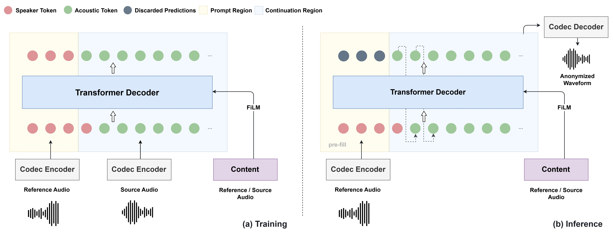

# LiveAnon: Improving Privacy and Utility in Streaming Speaker Anonymization with Codec Language Models

<p align="center">
  <a href="#"></a>
  <a href="https://jin1025.github.io/LiveAnon/"></a>
</p>

<div align="center">
  <b>Yejin Kim<sup>*</sup>, Kyungsu Kim<sup>*</sup>, Seungu Han<sup>*</sup>, Kyogu Lee<sup>*†‡</sup></b>
  <br>
  <sup>*</sup>Music and Audio Research Group (MARG)
  <br>
  <sup>†</sup>Department of Intelligence and Information, Seoul National University
  <br>
  <sup>‡</sup>Interdisciplinary Program in Artificial Intelligence, Seoul National University
</div>

## Architecture

LiveAnon is a streaming speaker anonymization framework built on an autoregressive codec language model.
A short reference utterance of a pseudo-speaker is encoded into codec tokens and placed at the front of the token sequence, and the model anonymizes the source speech by continuing that sequence.
Linguistic content is extracted by a streaming Zipformer ASR encoder and conditions the causal Transformer decoder through FiLM.
A capped delay pattern generates the RVQ codebooks partially in parallel, which shortens the streaming latency.

<p align="center">
  
</p>

## Installation

```bash
git clone https://github.com/Jin1025/LiveAnon.git
cd LiveAnon

conda create -n liveanon python=3.10 -y
conda activate liveanon

# PyTorch (choose the CUDA build that matches your driver)
pip install torch==2.6.0 torchaudio==2.6.0 --index-url https://download.pytorch.org/whl/cu124

pip install -r requirements.txt
```

LiveAnon uses two pretrained third-party models. Their weights are downloaded from Hugging Face automatically the first time you run inference:

- [JHCodec](https://github.com/jhcodec843/jhcodec) (neural audio codec, installed by `requirements.txt`): [jhcodec/jhcodec](https://huggingface.co/jhcodec/jhcodec)
- [icefall](https://github.com/k2-fsa/icefall) streaming Zipformer (content encoder, code included in `liveanon/zipformer/`): [Zengwei/icefall-asr-librispeech-streaming-zipformer-2023-05-17](https://huggingface.co/Zengwei/icefall-asr-librispeech-streaming-zipformer-2023-05-17)

We recommend installing [FlashAttention](https://github.com/Dao-AILab/flash-attention), which we used for all our results:
```bash
pip install flash-attn --no-build-isolation
```
Without it, JHCodec falls back to a standard attention implementation, which works but gives slightly different outputs.

## Inference

Offline inference
```bash
python inference.py \
    --ckpt <path_to_checkpoint> \
    --source <path_to_source_audio> \
    --reference <path_to_reference_audio> \
    --output <path_to_output_audio>
```

Streaming inference
```bash
python inference.py \
    --ckpt <path_to_checkpoint> \
    --source <path_to_source_audio> \
    --reference <path_to_reference_audio> \
    --output <path_to_output_audio> \
    --streaming \
    --chunk_ms 20  # chunk size in milliseconds
```
In streaming mode, the source is processed chunk by chunk (`--chunk_ms`), and the anonymized audio is output progressively.
The reference is trimmed of leading and trailing silence and cropped to a 3-second prompt (`--ref_sec`).

## Acknowledgements

- [JHCodec](https://github.com/jhcodec843/jhcodec): streaming neural audio codec
- [icefall](https://github.com/k2-fsa/icefall): streaming Zipformer ASR encoder. Its model code is included in `liveanon/zipformer/` with small modifications for streaming inference (marked in each file).

## License

This project is released under the [Apache License 2.0](LICENSE).
